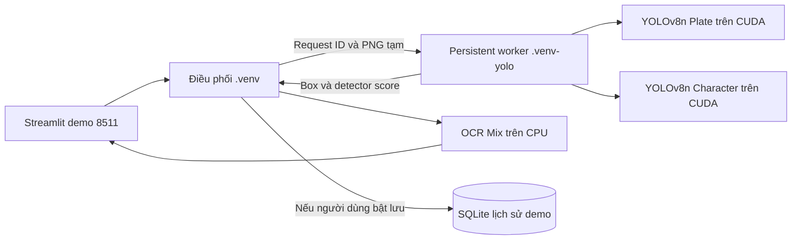
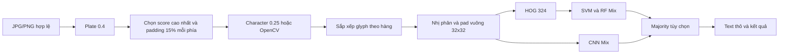

# Kiến trúc ALPR

Hai YOLOv8n chỉ tìm box: Plate tìm biển trên ảnh gốc, Character tìm glyph không phân lớp ký tự trên crop. OpenCV giải mã, crop, nhị phân hóa và chuẩn hóa; hai đối chứng OpenCV dùng contour, với `border_components` bỏ thành phần nối biên. YOLO Character cải thiện segmentation trên development nhưng cần GPU và có thể bỏ/thừa glyph. HOG tóm tắt hướng gradient thành 324 đặc trưng; SVM RBF tìm biên quyết định sau scaler, RF bỏ phiếu qua cây (không cần scaler), CNN học đặc trưng từ ảnh 32×32×1 và rescale nội bộ. Majority dùng ít nhất hai phiếu trong ba, không đa số trả `?`; không hiệu chỉnh xác suất.

Worker giữ hai checkpoint và warmup một lần mỗi tiến trình, đồng bộ CUDA để đo predict, tuần tự hóa IPC, có timeout và khởi động lại ở yêu cầu tiếp theo sau lỗi. Classifier cache trong Streamlit; không cache prediction. SQLite demo chỉ lưu metadata khi bật lưu, tách khỏi SQLite nhãn test và train. Không có PaddleOCR trong demo.